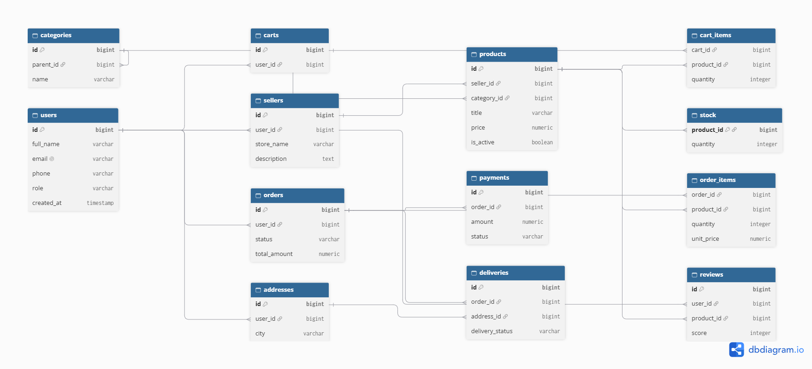

# Лабораторная работа №1. Проектирование базы данных маркетплейса

## 1. Анализ предметной области и бизнес-правила
1. Пользователь может быть покупателем, а также владельцем магазина-продавца.
2. Продавец размещает множество товаров.
3. Товар принадлежит ровно одному продавцу и относится к одной категории.
4. Категория может иметь родительскую категорию (иерархия).
5. Заказ оформляется одним пользователем и содержит одну или несколько позиций.
6. Один товар может входить в множество заказов (связь M:N через order_items).
7. Отзыв оставляется конкретным пользователем к конкретному товару.

## 2. ER-диаграмма

## 3. Нормализация до 3НФ
*   **1НФ:** Все значения атомарны.
*   **2НФ:** Все неключевые атрибуты зависят от всего первичного ключа.
*   **3НФ:** Устранены транзитивные зависимости (например, данные продавца хранятся только в таблице `sellers`, а в `products` только `seller_id`).

## 4. Выбор ключей
Для всех таблиц выбраны суррогатные ключи (`BIGINT GENERATED ALWAYS AS IDENTITY`), так как они стабильны и не меняются со временем, в отличие от естественных.

## 5. Словарь данных
| Таблица | Столбец | Тип данных | Ограничения | Назначение |
| :--- | :--- | :--- | :--- | :--- |
| **users** | id | BIGINT | PK, Identity | Уникальный идентификатор |
| | full_name | VARCHAR(255) | NOT NULL | ФИО пользователя |
| | email | VARCHAR(255) | UNIQUE, NOT NULL | Электронная почта |
| **products** | id | BIGINT | PK, Identity | Идентификатор товара |
| | seller_id | BIGINT | FK, NOT NULL | Ссылка на продавца |
| | price | NUMERIC(12,2) | CHECK (price > 0) | Цена товара |
